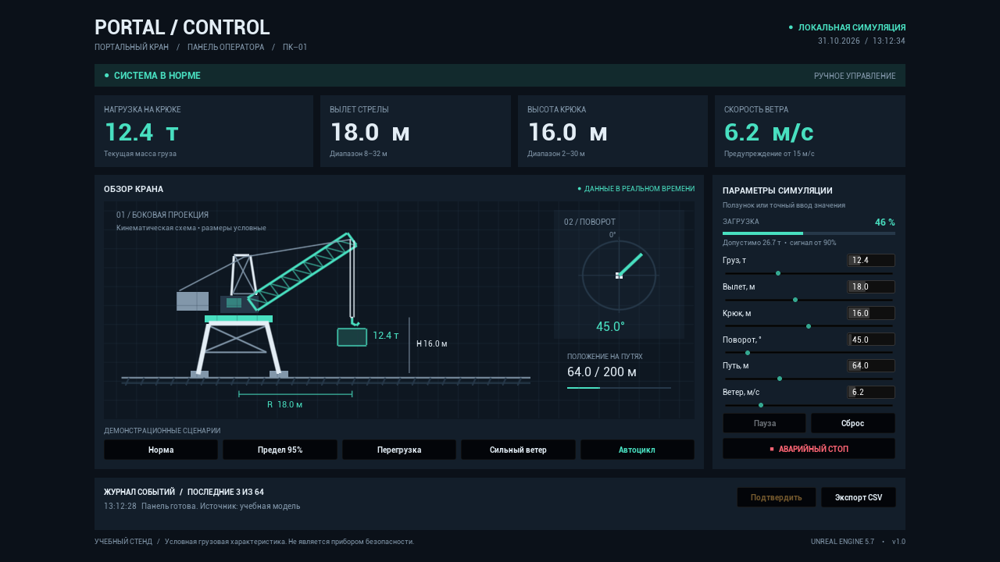

# PORTAL / CONTROL — панель портального крана

Самостоятельная демонстрация **Unreal Engine 5.7**, интерфейс на русском языке. Нативная панель Slate размещена в `UUserWidget`; показания и сценарии находятся в отдельном Blueprint-доступном компоненте. Интернет, сторонние плагины и внешние модели для работы не требуются.



[Сценарий перегрузки](Docs/Preview-overload.png) · [Результаты сборки и проверок](Docs/VALIDATION.md).

## Запуск

Необходимы UE 5.7, Microsoft C++ Build Tools 2022 (MSVC v143, рекомендуемая версия 14.44), Windows SDK 10.0.22621 или новее, а также **.NET Framework 4.8 SDK и Targeting Pack**. Последние два компонента нужны UnrealBuildTool для редакторской сборки, даже если приложение написано на C++.

Список компонентов сохранён в `.vsconfig`: его можно импортировать в Visual Studio Installer на другом компьютере.

В PowerShell из папки проекта:

```powershell
powershell -ExecutionPolicy Bypass -File .\Tools\Build.ps1
powershell -ExecutionPolicy Bypass -File .\Tools\Run.ps1
```

Для запуска двойным щелчком используйте `Launch.cmd`.

Если UE установлен в другой папке, добавьте `-EngineRoot 'D:\Epic Games\UE_5.7'` к каждой команде. `Run.ps1` собирает проект, если модуль ещё отсутствует. Для пересборки после изменения исходников используйте `Build.ps1`.

Также можно открыть `PortalCrane.uproject`, согласиться на сборку модуля и нажать **Play**. Используется встроенная карта `/Engine/Maps/Entry`; GameMode создаёт панель автоматически. Отдельные `.umap`/`.uasset` не нужны. Alt+F4 закрывает самостоятельную демонстрацию.

## Управление

| Элемент | Действие |
|---|---|
| Ползунки справа | Меняют массу, вылет, высоту, поворот, положение на путях и ветер |
| Числовое поле рядом с параметром | Точный ввод; значения ограничены диапазоном |
| Норма | Начальные показания |
| Предел 95% | Предупреждение о приближении к допустимой нагрузке |
| Перегрузка | Масса 30 т при вылете 18 м, загрузка 112,5% |
| Сильный ветер | Ветер 23 м/с |
| Автоцикл | Плавное изменение показаний и схемы крана |
| Пауза / Продолжить | Приостанавливает и возобновляет автоцикл |
| Аварийный стоп | Замораживает демонстрацию, блокирует регуляторы и сценарии до сброса |
| Сброс | Снимает стоп и возвращает начальные показания |
| Подтвердить | Отмечает текущий набор предупреждений как просмотренный, не устраняя причины |
| Экспорт CSV | Сохраняет последние 64 события в `Saved/CraneLogs` в UTF-8 |

Ручное изменение любого параметра прекращает автоцикл. При появлении или исчезновении причины предупреждения требуется новое подтверждение. Одновременные предупреждения отображаются вместе. В панели видны три последних события; CSV содержит весь буфер. Часы и журнал используют локальное время Windows.

## Учебная модель

Это визуальный симулятор индикаторов, **не система управления реальным краном и не прибор безопасности**. Грузовая характеристика и пороги заданы для демонстрации; они не воспроизводят настройки конкретной модели ОГМ240.

`Qдоп = min(32, 480 / R)` т, где `R` — вылет в метрах. Загрузка: `100 × Q / Qдоп`.

| Сигнал | Предупреждение | Аварийная индикация |
|---|---|---|
| Загрузка | ≥ 90% | ≥ 100% |
| Ветер | ≥ 15 м/с | ≥ 20 м/с |
| Высота крюка | ≤ 3 или ≥ 29 м | — |
| Кнопка стоп | — | До явного сброса |

Вылет, крюк и положение на путях меняют боковую схему. Угол поворота показан на отдельном виде сверху. Это условный чертёж, а не физическая или трёхмерная модель крана. Предупреждения о перегрузке и ветре не блокируют регуляторы, чтобы можно было исследовать переходы состояний. Кнопка стоп останавливает только симуляцию.

## Проверки

После сборки:

```powershell
powershell -ExecutionPolicy Bypass -File .\Tools\Test.ps1
powershell -ExecutionPolicy Bypass -File .\Tools\Run.ps1 -Screenshot -Scenario overload
```

Automation-тесты `PortalCrane.Telemetry.Thresholds` и `PortalCrane.Telemetry.Controls` проверяют граничные значения, одновременные тревоги, подтверждение, смену режима, паузу, стоп, сброс, ограничение входных значений и объёма журнала. Отчёт: `Saved/TestReport`. Снимок панели через пять секунд: `Saved/Screenshots/CranePanel.png`.

Для ручной проверки: измените все шесть регуляторов; включите каждую сцену; приостановите автоцикл; измените значение вручную; нажмите стоп, подтвердите его и выполните сброс; экспортируйте журнал. Проверьте окно разных размеров: весь интерфейс масштабируется с сохранением пропорций.

## Подключение к Blueprint

1. Добавьте **Crane Telemetry Component** на Actor.
2. Создайте **Crane Panel Widget**, передайте компонент в параметр `Telemetry` **до** `Add to Viewport`.
3. Для обновления используйте `Set Readings` (структура `FCraneReadings`) или `Set Parameter` (индексы: груз 0, вылет 1, крюк 2, поворот 3, путь 4, ветер 5).
4. Событие `On Readings Changed` позволяет синхронизировать собственную модель; доступ к состоянию — через `Readings`, `Get Capacity`, `Get Utilization`, `Get Severity`.

Основные файлы: `CraneTelemetryComponent.*` — данные и сценарии, `CranePanelWidget.*` — интерфейс и схема, `CraneGameMode.*` — запуск. Внешние датчики, физическая модель и реальные таблицы грузоподъёмности в эту демонстрацию не входят.

## Референсы

- [ОГМ240 для портальных кранов](https://rezonans-tech.ru/catalog/systems/lmi/ogm240/portal-cranes/) — состав отображаемых нагрузочных и геометрических параметров.
- [Портальные краны, Крановый завод «ГОСТ»](https://zavodcranov.ru/portalnyye-krany) — тип и конструктивная схема крана.
- [Jinglian, пример индикатора](https://jingliancrane.en.made-in-china.com/product/kwAtqesySHWb/China-Construction-Machine-Load-Moment-Limiter-for-Crawler-Crane.html) — общий пример промышленной индикации ветра.
- [Epic: настройка Visual Studio](https://dev.epicgames.com/documentation/en-us/unreal-engine/setting-up-visual-studio-development-environment-for-cplusplus-projects-in-unreal-engine?application_version=5.7).

Изображения и фирменные интерфейсы производителей не копировались; оформление панели оригинальное.
